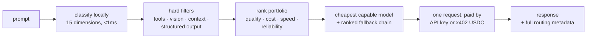

<div align="center">

# @blockrun/llm

### Cut your LLM bill by <!-- br:savings.autoVsBaselinePct -->84<!-- /br:savings.autoVsBaselinePct -->%. One line of TypeScript.

The smart-routing SDK for <!-- br:models.chatVisible -->88<!-- /br:models.chatVisible --> models — every request goes to the cheapest model that can handle it,
paid with an API key or per-request USDC on Solana, Base or Arc. No vendor lock-in.

[](https://www.npmjs.com/package/@blockrun/llm)
[](https://www.npmjs.com/package/@blockrun/llm)
[](https://github.com/BlockRunAI/blockrun-llm-ts/actions)
[](LICENSE)
[](package.json)
[](tsconfig.json)

[](https://user.blockrun.ai)
[](https://solana.com)
[](https://base.org)
[](https://x402.org)
[](https://t.me/blockrunAI)

[Sign up / Get an API key](https://user.blockrun.ai) · [Website](https://blockrun.ai) · [Models & Pricing](https://blockrun.ai/models) · [ClawRouter](https://github.com/BlockRunAI/ClawRouter) · [Python SDK](https://github.com/BlockRunAI/blockrun-llm) · [Telegram](https://t.me/blockrunAI)

</div>

---

```typescript
import { LLMClient } from '@blockrun/llm';

// Reads BLOCKRUN_API_KEY (sign up at https://user.blockrun.ai),
// or BASE_CHAIN_WALLET_KEY if you'd rather pay per request in USDC.
const client = new LLMClient();

const r = await client.smartChat('Prove step by step that the sum of two odd integers is even.');
console.log(r.model);            // 'deepseek/deepseek-v4-pro': a strong reasoner, not the frontier flagship
console.log(r.routing.savings);  // e.g. 0.83: this request cost 83% less than the baseline
console.log(r.response);         // the proof
```

**<!-- br:savings.autoVsBaselinePct -->84<!-- /br:savings.autoVsBaselinePct -->% cheaper than pinning Claude Opus 5** across a realistic workload on the default `auto` profile, **<!-- br:savings.ecoVsBaselinePct -->98<!-- /br:savings.ecoVsBaselinePct -->%** on `eco`, which tries the free tier first. How that is measured: [Smart Routing](#smart-routing-router-core-v3).

## Why This SDK

- 🧠 **Smart routing that pays for itself.** The bundled [Router Core V3](https://github.com/BlockRunAI/router-core) engine (shared with [ClawRouter](https://github.com/BlockRunAI/ClawRouter)) classifies every request locally in <1ms across <!-- br:clawrouter.dimensions -->15<!-- /br:clawrouter.dimensions --> dimensions and routes to the cheapest capable model.
- 🆓 **<!-- br:models.free -->7<!-- /br:models.free --> genuinely free models.** $0 in and out, including two 1M-context Nemotrons, two that accept images, and free coding models from Cohere and Poolside.
- 🔐 **Two ways to connect.** A **BlockRun API key** billed against account credit ([sign up](https://user.blockrun.ai), [create a key](https://user.blockrun.ai/dashboard/keys), [add credit](https://user.blockrun.ai/dashboard/credits)), or a wallet signature with x402 micropayments and no account at all. Same code either way.
- 💸 **Pay per request in USDC.** x402 micropayments on Solana, Base or Arc. Agents can fund and pay their own way.
- 🛡️ **Automatic failover.** Transient errors (timeouts, 429, 5xx) before payment walk the router's ranked fallback chain instead of failing your request; a failure after a payment was sent never buys a second model.
- ⚡ **Streaming, OpenAI & Anthropic compat.** Drop-in `chat.completions` / `messages` layers, SSE streaming, strict TypeScript.
- 🎨 **Beyond chat.** Image, video, music, speech, live search, prediction markets, market data, and <!-- br:chains.rpc -->40<!-- /br:chains.rpc -->-chain RPC through the same API key or wallet.

## How It Compares

|                    | OpenAI SDK     | OpenRouter        | LiteLLM          | **@blockrun/llm**                                                       |
| ------------------ | -------------- | ----------------- | ---------------- | ----------------------------------------------------------------------- |
| **Cost routing**   | ✗ one vendor   | Manual selection  | Manual selection | **Automatic — <!-- br:savings.autoVsBaselinePct -->84<!-- /br:savings.autoVsBaselinePct -->% cheaper** |
| **Models**         | GPT only       | 200+              | 100+ (BYO keys)  | **<!-- br:models.chatVisible -->88<!-- /br:models.chatVisible -->, one credential** |
| **Free tier**      | ✗              | Rate-limited      | ✗                | **<!-- br:models.free -->7<!-- /br:models.free --> models, no signup**  |
| **Auth**           | API key        | Account + API key | Your API keys    | **API key *or* wallet signature**                                       |
| **Payment**        | Card + invoice | Credit card       | BYO keys         | **Account credit or USDC per-request**                                  |
| **Agent-ready**    | ✗              | ✗                 | ✗                | **✓ — one key, or agents fund their own wallet**                        |

## Installation

```bash
npm install @blockrun/llm   # Account API keys, Base and Arc wallets; smart routing included
```

<details>
<summary><strong>Solana payments</strong> — two more optional peers</summary>

```bash
npm install @blockrun/llm @solana/web3.js @solana/spl-token
```

Why they are not automatic: `@solana/spl-token` pulls in `bigint-buffer`, whose
native `toBigIntLE()` has an unpatched buffer overflow
([GHSA-3gc7-fjrx-p6mg](https://github.com/advisories/GHSA-3gc7-fjrx-p6mg)) with no
fixed release anywhere. As an optional *dependency* it landed in the lockfile of
every consumer, including projects that only ever pay on Base. As an optional
*peer* it reaches only the projects that ask for Solana. Calling a Solana path
without them throws an error naming the exact install command.

</details>

<details>
<summary><strong>Supported chains</strong> — Solana (recommended), Base, Arc, Base Sepolia</summary>

Only relevant in wallet mode; an account API key is chain-independent.

| Chain | Network | Payment | Notes |
|-------|---------|---------|-------|
| **Solana** | Solana Mainnet | USDC (SPL) | Recommended for new wallets; `SolanaLLMClient` |
| **Base** | Base Mainnet (`eip155:8453`) | USDC | `LLMClient`; settled by the Coinbase CDP facilitator |
| **Arc** | Circle Arc (`eip155:5042`) | USDC | `LLMClient` with `apiUrl: 'https://arc.blockrun.ai/api'`; settled by Circle's facilitator |
| **Base Sepolia** | Base Sepolia (`eip155:84532`) | Testnet USDC | Development |

**Protocol:** x402 v2.

</details>

The Anthropic SDK is a runtime dependency because the public compatibility wrapper exposes its types. Solana signing dependencies remain optional and are unnecessary for account billing.

## Documentation map

| If you want to… | Start here |
|-----------------|------------|
| Let the SDK choose the cheapest capable model | [Smart Routing](#smart-routing-router-core-v3) |
| Try it for $0 | [Try It Free](#try-it-free-no-usdc-required) and [Free Tier](#free-tier) |
| Understand wallet payments and settlement | [How Payment Works](#how-payment-works) |
| Pay from a Solana wallet | [Solana Support](#solana-support) |
| Enable metered batch settlement | [Batch settlement](#batch-settlement-optional-metered-billing) and the [full reference](https://github.com/BlockRunAI/blockrun-llm-ts/blob/main/docs/solana-batch.md) |
| Stream tokens, use tools | [Chat, Tools and Streaming](#chat-tools-and-streaming) |
| Generate media or query data services | [Models and Service APIs](#models-and-service-apis) |
| Use the OpenAI or Anthropic SDK surface | [OpenAI and Anthropic Compatibility](#openai-and-anthropic-compatibility) |
| Create, find or import a wallet | [Wallets](#wallets) |
| Configure production credentials safely | [Configuration and Environment Variables](#configuration-and-environment-variables) and [Security](#security) |

## Quick Start

Choose one billing mode. The chat and routing APIs are the same in every mode.

| Mode | Credential | Settlement | Best for |
|------|------------|------------|----------|
| **Account** | `BLOCKRUN_API_KEY` | BlockRun account credit | Applications and teams that want the simplest setup |
| **Solana wallet** | `SOLANA_WALLET_KEY` | Per-request USDC over x402 | Agents and non-custodial workloads; recommended wallet chain |
| **Base wallet** | `BASE_CHAIN_WALLET_KEY` | Per-request USDC over x402 | Existing EVM wallets and Base-native applications (the same key pays on Arc) |

Credential precedence is deterministic. An explicit `apiKey` wins over the
environment, and an explicit `privateKey` selects wallet mode even when
`BLOCKRUN_API_KEY` is set; passing both explicitly is an error. With no explicit
credential, `BLOCKRUN_API_KEY` beats the wallet key env vars, so a process holding
both runs in account mode. An invalid or exhausted API key never falls back to a
wallet payment.

### Account API key

1. [Sign up or sign in](https://user.blockrun.ai).
2. Create a key on [API Keys](https://user.blockrun.ai/dashboard/keys) and add credit on [Credits](https://user.blockrun.ai/dashboard/credits).
3. Set the key and use any SDK client. No wallet or payment chain is required.

```bash
export BLOCKRUN_API_KEY=brk_live_...
```

```typescript
import { LLMClient, ImageClient, VideoClient, BlockrunClient } from '@blockrun/llm';

const llm = new LLMClient(); // reads BLOCKRUN_API_KEY

// Let the router pick the cheapest capable model...
const routed = await llm.smartChat('Explain x402 in one paragraph.');
console.log(routed.model, routed.response);

// ...or pin one yourself
console.log(await llm.chat('openai/gpt-5.2', 'Hello!'));

const images = new ImageClient({ apiKey: process.env.BLOCKRUN_API_KEY });
const videos = new VideoClient(); // same account; async jobs are polled for you
const api = new BlockrunClient();  // generic access, e.g. the Responses API
const response = await api.post('/v1/responses', { model: 'openai/gpt-5.2', input: 'Hello!' });
```

Every client accepts `apiKey`: the service clients, `SolanaLLMClient`, and the
OpenAI/Anthropic compatibility wrappers. Usage and charges are on
[Activity](https://user.blockrun.ai/dashboard/activity). Keep API keys in server
or local environment variables, never in browser code or logs. Base URL
overrides, retry and polling rules, and switching back to a wallet are under
[Account mode details](#account-mode-details).

### Solana wallet

```typescript
import { setupAgentClient, SolanaLLMClient } from '@blockrun/llm';

// Uses BLOCKRUN_API_KEY when set. Otherwise it honours a saved chain preference,
// keeps an existing Base-only wallet on Base, and creates new wallets on Solana.
const client = await setupAgentClient();
const routed = await client.smartChat('Explain photosynthesis.');
console.log(routed.model, routed.response);

// Or construct the Solana client explicitly (needs the Solana peers from Installation above).
const solana = new SolanaLLMClient({ privateKey: process.env.SOLANA_WALLET_KEY });
console.log(await solana.chat('deepseek/deepseek-chat', 'gm')); // pin a model
```

### Base wallet

```typescript
import { LLMClient } from '@blockrun/llm';

const client = new LLMClient(); // BASE_CHAIN_WALLET_KEY; the key signs locally and is never sent

// Recommended: let the router pick the cheapest capable model
const result = await client.smartChat('Hello!');
console.log(result.model, result.response);

// Or pin a model yourself
const reply = await client.chat('openai/gpt-5.4', 'Hello!');
```

That's it. The SDK handles the x402 payment, and `smartChat()` keeps the bill
down on every request. The router is bundled: no extra package to install.
To pay on Arc instead, point the same client at Arc's gateway; see
[Arc Support](#arc-support).

### Try It Free (No USDC Required)

Want to kick the tires before funding a wallet? Use BlockRun's free tier:

```typescript
import { LLMClient } from '@blockrun/llm';

// The client still needs a wallet key or an API key to construct, but free
// models are answered without a payment: nothing is signed and nothing is charged.
const client = new LLMClient();

// Option 1: call a free model directly (guaranteed $0)
const reply = await client.chat('nvidia/nemotron-3.5-lightning', 'Explain x402 in 1 sentence');

// Option 2: let the router pick: 'eco' ranks the free tier first
const result = await client.smartChat('What is the capital of France?', { routingProfile: 'eco' });
console.log(result.model);           // a free model, e.g. 'nvidia/nemotron-3.5-lightning'
console.log(result.response);        // 'The capital of France is Paris.'
console.log(result.routing.savings); // 1 (100%)
```

The seven free models are listed under [Free Tier](#free-tier). `eco` lands on
a free model when one can handle the request and moves to the cheapest paid
model when none can; pin a free id when the call must cost $0.

## Smart Routing (Router Core V3)

Let the SDK pick the cheapest capable model for each request: **<!-- br:savings.autoVsBaselinePct -->84<!-- /br:savings.autoVsBaselinePct -->% cheaper than pinning Claude Opus 5** for the same traffic on `auto`, **<!-- br:savings.ecoVsBaselinePct -->98<!-- /br:savings.ecoVsBaselinePct -->%** on `eco`.

Not an "up to" figure. The baseline, the workload mix and the token ratio are
published in [`savings-mix.json`](https://github.com/BlockRunAI/blockrun/blob/main/src/brand/savings-mix.json),
priced against the live catalog, so anyone can recompute the claim and get the
same answer. The per-request `routing.savings` on each response is measured
against router-core's baseline model, `anthropic/claude-opus-4.7`, which is
priced the same as Claude Opus 5 ($5 input / $25 output per million tokens).

Smart routing is powered by the product-neutral
[`@blockrun/router-core`](https://github.com/BlockRunAI/router-core) V3 engine,
the same deterministic portfolio router that drives
[ClawRouter](https://github.com/BlockRunAI/ClawRouter). It is **bundled into
this SDK**: no separate router package to install, and the routing decision
runs locally with no extra model call.

Three ways to use it:

```typescript
import { LLMClient, type ChatMessage, type Tool } from '@blockrun/llm';

const client = new LLMClient();
const messages: ChatMessage[] = [{ role: 'user', content: 'What is the weather in Paris?' }];
const tools: Tool[] = [{
  type: 'function',
  function: {
    name: 'get_weather',
    description: 'Current weather for a city',
    parameters: { type: 'object', properties: { city: { type: 'string' } }, required: ['city'] },
  },
}];

// 1. smartChat(): one-line routed chat
const result = await client.smartChat('What is the capital of France?');
console.log(result.model); // 'google/gemini-2.5-flash'
console.log(`Saved ${(result.routing.savings * 100).toFixed(0)}%`); // 'Saved 90%': this request vs the baseline

// 2. smartChatCompletion(): full agent / tool conversations, routed
const agent = await client.smartChatCompletion(messages, { tools, toolChoice: 'auto' });

// 3. Model aliases: blockrun/auto | blockrun/eco | blockrun/premium
const reply = await client.chatCompletion('blockrun/auto', messages);

// Inspect a decision without paying for anything
const decision = await client.route('Prove the Riemann hypothesis step by step');
console.log(decision.model);       // 'deepseek/deepseek-v4-pro'
console.log(decision.method);      // 'portfolio'
console.log(decision.taskType);    // 'reasoning'
console.log(decision.candidates);  // ranked, capability-eligible models
console.log(decision.fallbacks);   // ['google/gemini-3.5-flash', 'deepseek/deepseek-reasoner', 'xai/grok-4.3', ...]
```

The aliases are resolved locally by `chat()` and `chatCompletion()` on both
`LLMClient` and `SolanaLLMClient`, by `LLMClient.chatCompletionStream()`, and by
the OpenAI-compatible wrapper. `SolanaLLMClient.stream()` and the
Anthropic-compatible wrapper (which proxies straight to the gateway's
`/v1/messages`) do **not** resolve them; pass a concrete model id there.

Example picks in this README reflect the live catalog when it was written. The
router re-ranks as models and prices move, so your output can differ.

### Automatic Fallback on Transient Errors

`smartChat()` populates a fallback chain from the portfolio ranking and
`chat()` / `chatCompletion()` walk it automatically when the primary model
returns a transient error — timeouts, network failures, 429 rate limits, or
5xx responses (502/503/504/522/524) — **before any payment was sent**. Other
4xx errors and `PaymentError` propagate immediately so wallet / auth issues
surface fast. (Solana's internal stale-blockhash re-sign is a separate,
lower-level retry inside the payment step — see [How Payment Works](#phase-2--every-request-pays-for-itself-automatic-x402).)

The next model is a new paid request, so the chain is only walked when the
failed request cannot have been charged. Every error from these calls carries
a retry disposition, which `retryDisposition(err)` returns:

- `'unpaid'`: nothing chargeable was sent — the unpaid first request and its
  402 challenge, or signing the payment. A 429, 5xx, timeout or network error
  here moves on to the next model. On Solana, a `503
  PAYMENT_VERIFICATION_UNAVAILABLE` in answer to the payment is `'unpaid'`
  too: the gateway sends it only when verification could not run, so nothing
  was settled or broadcast (the batch path already treats it as a refusal).
  This holds on every exact-paid Solana endpoint, not only chat.
- `'paid-or-in-doubt'`: the signed payment (exact or batch) was sent and may
  have been charged — a timeout, abort or network error after sending it, any
  error status in answer to it, or a 2xx whose body could not be read. The
  error propagates; no other model is bought for the call. With an API key
  the request itself is billed, so only the account API's explicit answers
  are `'unpaid'`: a 4xx (such as a 429), or a 5xx carrying its JSON error
  envelope (api.blockrun.ai debits only an accepted 2xx). An HTML or empty
  5xx from a proxy, or a timeout, is not.

An error without a disposition counts as `'paid-or-in-doubt'`. Use the same
check in your own retry wrapper, or pass your own fallback chain:

```typescript
import { LLMClient, retryDisposition } from '@blockrun/llm';

const client = new LLMClient();

try {
  await client.chat('openai/gpt-5.2', 'hello');
} catch (err) {
  if (retryDisposition(err) !== 'unpaid') throw err; // may have been charged: never resend
  // safe to retry: nothing was paid
}

// Manually pass a fallback chain to chat() / chatCompletion()
const reply = await client.chat('nvidia/nemotron-3.5-lightning', 'hello', {
  fallbackModels: ['nvidia/nemotron-3-ultra-550b', 'cohere/north-mini-code'],
});
// If nemotron-3.5-lightning times out, the SDK retries against the next model
// and logs each hop to stderr: "[@blockrun/llm] <from> -> <to> (...)".
```

### Routing Profiles

| Profile | Strategy | Savings vs Opus 5 | Best For |
|---------|----------|-------------------|----------|
| `eco` | Cheapest capable model — ranks the <!-- br:models.free -->7<!-- /br:models.free -->-model free tier first | **<!-- br:savings.ecoVsBaselinePct -->98<!-- /br:savings.ecoVsBaselinePct -->%** | Cost-sensitive production, zero-cost testing |
| `auto` | Best balance of cost and quality (default) | **<!-- br:savings.autoVsBaselinePct -->84<!-- /br:savings.autoVsBaselinePct -->%** | General use |
| `premium` | Highest-quality model per tier | 0% | Quality-critical tasks |

There is no `free` routing profile: `routingProfile` accepts
`'eco' | 'auto' | 'premium'`. (ClawRouter's `/model free` belongs to its own
proxy, not to this SDK's router options.) For guaranteed $0, call a
[free model](#free-tier) directly with `chat()`; for smart-routed $0-first,
use `eco`.

```typescript
import { LLMClient } from '@blockrun/llm';

const client = new LLMClient();

// Use premium models for quality-critical tasks
const result = await client.smartChat(
  'Write production-grade async TypeScript code',
  { routingProfile: 'premium' }
);
console.log(result.model);  // 'openai/gpt-5.3-codex'
```

### How the Router Works



Auto uses the deterministic **Router Core V3.5 portfolio strategy**
(`DEFAULT_ROUTING_CONFIG.version` in the pinned engine): it classifies the task shape locally across
<!-- br:clawrouter.dimensions -->15<!-- /br:clawrouter.dimensions --> dimensions
(token count, code presence, reasoning markers, technical/creative terms,
agentic patterns, …), enforces tool / vision / structured-output / context
constraints as **hard filters**, then ranks an ordered candidate portfolio.
The winner becomes `routing.model`; the rest surface as `routing.candidates`
and feed the transient-error fallback chain. Classification is local and
deterministic: <1ms, no extra model call. (The SDK reads `/v1/models` once to
price candidates; the catalog is cached.)

Classification still maps to one of four tiers (`routing.tier`). Each
tier × profile has a designated primary (what the rules strategy —
`routing.method: 'rules'`, the rollback lever — routes to directly, and what
anchors the portfolio's candidate pool):

| Tier | Example Tasks | ECO | AUTO | PREMIUM |
|------|---------------|-----|------|---------|
| SIMPLE | "What is the capital of France?", definitions | nemotron-3.5-lightning (**FREE**) | gemini-2.5-flash | gemini-2.5-flash |
| MEDIUM | Code snippets, explanations | glm-5.3-flash | gemini-3.5-flash | gpt-5.3-codex |
| COMPLEX | Architecture, long documents | glm-5.3-flash | gemini-3.1-pro | claude-fable-5 |
| REASONING | Proofs, multi-step reasoning | deepseek-reasoner | deepseek-reasoner | claude-sonnet-5 |

This table mirrors the pinned router-core `DEFAULT_ROUTING_CONFIG`;
`routing.tierConfigs` on any decision returns the map that decision used.

The router's ranking is used as-is. It can pick a model the gateway serves but
does not list on `/v1/models` (for example `nvidia/nemotron-3-nano-30b`, which
appears in `eco` fallback chains); the gateway serves those ids directly. The
only rewrite is ClawRouter's proxy namespace: `free/<model>` ids map to their
`nvidia/<model>` gateway ids, and are dropped when there is no mapping.

### Routing Metadata Reference

Every `smartChat()` result carries the full decision on `result.routing`
(type `RoutingDecision`) — enough to log, audit, or replay why a model was
picked:

| Field | Description |
|-------|-------------|
| `model` | Selected model id (same as `result.model`) |
| `method` | `'portfolio'` (the Auto default), `'rules'` (rollback strategy), or `'llm'` |
| `tier` | Task tier: `'SIMPLE'`, `'MEDIUM'`, `'COMPLEX'`, or `'REASONING'` |
| `taskType` | Portfolio task classification: `'chat'`, `'extraction'`, `'code_edit'`, `'code_agent'`, `'tool_agent'`, `'debug'`, `'reasoning'`, `'reasoning_math'`, `'long_context'`, `'vision'`, … |
| `candidates` | Ordered, capability-eligible models ranked by the portfolio router; the first entry is `model` |
| `candidateScores` | Per-candidate score breakdown (`quality` / `cost` / `speed` / `reliability`), ordered with `candidates` |
| `fallbacks` | The chain `chat()` walks on transient errors before payment (timeout / network / 429 / 5xx) — `candidates` minus the primary, with ClawRouter's proxy-namespace `free/*` ids mapped to their `nvidia/*` gateway ids (SDK-computed) |
| `savings` | 0–1 fraction saved vs the baseline model (`anthropic/claude-opus-4.7`, priced like Opus 5) |
| `costEstimate` / `baselineCost` | Estimated cost of the pick vs that baseline, in USD |
| `confidence` | Sigmoid-calibrated classifier confidence, 0–1 |
| `routerVersion` | `'v3-portfolio'` or `'v2-rules'` |
| `profile` | Routing profile applied: `'auto'`, `'eco'`, `'premium'`, or `'agentic'` |
| `reasoning` | Human-readable explanation of the decision |
| `tierConfigs` | The tier → primary/fallback map the decision was made against |

**Search and routing.** xAI search (`x_search` / `web_search` tools, or
`search` / `searchParameters` not set to `mode: 'off'`) runs on `xai/*` models
only. When a routed call asks for search, the candidate chain is narrowed to
its `xai/*` models in the router's order; when the route has none, `route()` /
`smartChat()` / `smartChatCompletion()` throw before anything is sent or paid.
For search, calling an `xai/*` model directly (e.g. `xai/grok-4.3`) is the
dependable path.

### TypeScript Types

Everything is typed. The routing types are derived from
[`@blockrun/router-core`](https://github.com/BlockRunAI/router-core), pinned to
a reviewed immutable commit, and shipped **inlined in this SDK's declaration
files and runtime bundle**, so you install nothing extra to route or to
typecheck.

```typescript
import {
  LLMClient,
  OpenAI,
  APIError,
  PaymentError,
  type ChatMessage,
  type ChatResponse,
  type ChatOptions,
  type ChatCompletionOptions,
  type Model,
  // Smart routing
  type SmartChatOptions,
  type SmartChatResponse,
  type SmartChatCompletionOptions,
  type SmartChatCompletionResponse,
  type RoutingDecision,
  type RoutingProfile,
  type RoutingTier,
  type RoutingTaskType,
  type RoutingTierConfig,
  // OpenAI-compatible layer
  type OpenAIChatCompletionResponse,
  type OpenAIChatCompletionChunk, // what the stream: true iterator yields
} from '@blockrun/llm';
```

### Going Deeper

- [ClawRouter](https://github.com/BlockRunAI/ClawRouter) — the router itself: OpenClaw plugin, standalone proxy for Cursor / continue.dev / any OpenAI-compatible client, Telegram integration
- [Routing profiles in depth](https://github.com/BlockRunAI/ClawRouter/blob/main/docs/routing-profiles.md) — ECO / AUTO / PREMIUM details
- [How the routing engine works](https://github.com/BlockRunAI/ClawRouter/blob/main/docs/smart-llm-router-14-dimension-classifier.md) — the classifier, dimension by dimension
- [Router benchmark](https://github.com/BlockRunAI/ClawRouter/blob/main/docs/llm-router-benchmark-46-models-sub-1ms-routing.md) — sub-1ms routing across the catalog
- [ClawRouter vs OpenRouter](https://github.com/BlockRunAI/ClawRouter/blob/main/docs/clawrouter-vs-openrouter-llm-routing-comparison.md) — head-to-head comparison
- [`@blockrun/router-core`](https://github.com/BlockRunAI/router-core) — the deterministic routing engine both share

## How Payment Works

In wallet mode no account or API key is needed. You hold USDC in your own
wallet, and **every request pays for itself** with an on-chain micropayment.
Two phases:

### Phase 1 — Fund your wallet once

First, have a wallet. `setupAgentClient()` creates one for you (see
[Wallets](#wallets)), or bring your own:

- **Solana:** create a wallet (Phantom, Backpack, Solflare, …) and set its bs58 secret key as `SOLANA_WALLET_KEY`.
- **Base / Arc:** create an EVM wallet (Coinbase Wallet, MetaMask, …) and set its private key as `BASE_CHAIN_WALLET_KEY`.

```bash
# .env (never commit it)
SOLANA_WALLET_KEY=...your_bs58_secret_key
BASE_CHAIN_WALLET_KEY=0x...
```

Then get USDC into it. You only do this when the balance runs low:

- **(a) Buy with a card (Base USDC).** Call `onramp()` to mint a one-time Coinbase Onramp link, then open the returned `pay.coinbase.com` URL: pay by card or bank in 60+ fiat currencies and the USDC lands in your wallet. The call itself is **free**. Onramp is **Base-only** (`LLMClient`), and the funding address must equal your signing wallet.
- **(b) Transfer existing USDC** to your wallet address: Base USDC for `LLMClient` on Base, USDC on Arc for Arc, Solana SPL USDC for `SolanaLLMClient`.
- **(c) Skip funding entirely.** Use the [free models](#free-tier): every call is **$0**, no balance required.

```typescript
import { LLMClient } from '@blockrun/llm';

const client = new LLMClient();

const { url } = await client.onramp(client.getWalletAddress());
console.log(`Fund your wallet: ${url}`);  // single-use, expires in ~5 min: mint it at click time

const balance = await client.getBalance(); // USDC on Base
console.log(`Balance: $${balance.toFixed(2)} USDC`);
```

$5 of USDC covers thousands of paid requests. `SolanaLLMClient` has its own
`getBalance()` (USDC on Solana) and an async `getWalletAddress()`.

### Phase 2 — Every request pays for itself (automatic x402)

You just call `client.smartChat(...)` or `client.chat(...)`; the payment is invisible:

1. The SDK sends the request to BlockRun's gateway.
2. The gateway answers **402 Payment Required** with the price.
3. The SDK signs the payment **locally** with your wallet key: an EIP-3009
   USDC authorization (EIP-712 typed data) on Base or Arc for `LLMClient`, an
   SPL `TransferChecked` transaction on Solana for `SolanaLLMClient`.
4. The request is retried automatically with the payment proof.
5. The gateway's facilitator settles on-chain and the AI response comes back.

One call, no separate pay step. Free-tier models settle at **$0** (no payment
signed). You pay no gas on any chain: the facilitator submits the transfer and
pays the network fee.

On **Solana**, step 3 pins the payment to a recent blockhash that is valid for
roughly 60 seconds. If one expires between signing and verification,
`SolanaLLMClient` re-signs against a fresh blockhash and retries — up to twice,
with a short backoff — rather than surfacing a payment error you would only
have to retry by hand.

The retry is deliberately narrow. It fires only when the gateway explicitly
reports a *verification-phase* stale blockhash. Settlement failures, ambiguous
rejections, insufficient funds and malformed responses all fail immediately.
Verification runs strictly before settlement, so a retryable rejection means no
transaction was broadcast and you cannot be charged twice.

### Track spend and verify settlements

```typescript
import { LLMClient, getCostSummary } from '@blockrun/llm';

const client = new LLMClient();

const spent = client.getSpending(); // this client, wallet mode only (throws with an API key)
console.log(`Spent $${spent.totalUsd.toFixed(4)} across ${spent.calls} calls`);

const summary = getCostSummary(); // across sessions, from ~/.blockrun/cost_log.jsonl
console.log(`Lifetime: $${summary.totalUsd.toFixed(2)} over ${summary.calls} calls`);
console.log('By model:', summary.byModel);
```

Only `LLMClient` wallet settlements (Base / Arc chat) are appended to
`~/.blockrun/cost_log.jsonl` automatically. Other clients count their payments
in their own `getSpending()`. Account usage lives on the
[Activity](https://user.blockrun.ai/dashboard/activity) page, not in-process.

In wallet mode, every paid request is a real on-chain USDC transfer — look up
your wallet address on [Basescan](https://basescan.org) (or a Solana or Arc
explorer) to verify each settlement independently. The exception is Solana
[batch settlement](#batch-settlement-optional-metered-billing): there the
on-chain records are the channel deposit and BlockRun's batched redemptions,
and each call is a signed voucher.

**Your private key never leaves your machine:** it is only used for local
signing. With per-request (`exact`) wallet payments, USDC moves from your
wallet for each request and BlockRun holds none of your funds. Two exceptions
to keep in mind: account credit is held by BlockRun on your account, and a
Solana batch channel escrows a deposit the operator can claim from, up to
`maxDeposit`.

## Solana Support

Pay for AI calls with Solana USDC via [sol.blockrun.ai](https://sol.blockrun.ai):

```typescript
import { SolanaLLMClient } from '@blockrun/llm';

// SOLANA_WALLET_KEY env var (bs58-encoded Solana secret key),
// or pass { privateKey: 'your-bs58-solana-key' } / { apiKey: 'brk_live_…' }
const client = new SolanaLLMClient();

// Same API as LLMClient: route first...
const routed = await client.smartChat('gm Solana: what is x402?');
console.log(routed.model, routed.response);

// ...or pin a model
const response = await client.chat('deepseek/deepseek-chat', 'gm Solana');

// Live Search with Grok
const trending = await client.chat('xai/grok-4.5', 'What is trending on X?', { search: true });

// xAI x_search on chosen accounts, structured output, real cost per call
const res = await client.chatCompletion('xai/grok-4.3', [
  { role: 'user', content: 'Which new models did these labs announce today? Return JSON.' },
], {
  tools: [{ type: 'x_search', allowedXHandles: ['OpenAI', 'AnthropicAI', 'xai'], fromDate: '2026-10-04' }],
  searchParameters: { maxTurns: 2 },          // bounds xAI's per-post search bill
  responseFormat: { type: 'json_object' },
  timeout: 180_000,
});
console.log(res.choices[0].message.annotations); // url_citation with positions
console.log(res.usage?.server_side_tool_usage);  // { x_posts_fetched, ... }
console.log(res.costUsd, res.settlement);        // what you paid, and the tx
```

`costUsd`, `settlement` and the per-call `timeout` work the same on `LLMClient`
(Base / Arc). `costUsd` is what the call added to `getSpending()`: the signed
price under `exact`, the metered `extra.chargedAmount` under batch settlement,
`0` for a free model; it is undefined in API-key mode (billed to the account).
When the gateway answers a paid request from a free fallback model it skips
settlement: `costUsd` is `0`, `settlement.skipped` is `"free-fallback"`, and
nothing is added to `getSpending()`.

**Setup:**
1. Export your Solana wallet key: `export SOLANA_WALLET_KEY="your-bs58-key"`
2. Fund it with USDC on Solana mainnet
3. That's it — payments are automatic via x402

**Endpoint:** `https://sol.blockrun.ai/api` · **Payment:** Solana USDC (SPL, mainnet)

**Images, music and video on Solana:**

```typescript
import { SolanaLLMClient } from '@blockrun/llm';

const client = new SolanaLLMClient();

const image = await client.image('a lighthouse at dusk', { model: 'openai/gpt-image-2' });
const track = await client.music('chill lo-fi beats with piano');
// Extra video options are sent verbatim, so use the gateway's snake_case names.
const video = await client.video('a red apple slowly spinning', { duration_seconds: 5 });
```

Slow jobs answer `202 { id, poll_url }` and the client polls for you. Each poll
proves the job is yours with a wallet signature (`x-poll-wallet`,
`x-poll-timestamp`, `x-poll-signature`: ed25519 over
`blockrun-poll:v1:<kind>:<job id>:<unix seconds>`), not a payment, so a
multi-minute job does not sign a Solana transaction every few seconds. Image
and music are paid when submitted. A video is charged only once it is finished:
the client signs one payment for the completed job, and a failed job costs
nothing. If the gateway does not accept the poll signature for a job, the client
falls back to paying each poll the old way (logged to stderr). Base polling is
unchanged.

### Batch settlement (optional metered billing)

By default every Solana call uses x402 `exact`: one SPL transfer per call,
priced at the request ceiling. Batch settlement replaces those per-call
transfers with a bounded payment channel: the client locks a small deposit
once, each request authorizes no more than its quoted ceiling, and the gateway
charges the **metered** cost after the response.

It is off unless you opt in. `BLOCKRUN_SOL_OPERATOR` is a public constant
exported by this SDK, not a secret or an environment variable; listing it in
`batch.operators` is the explicit decision that this wallet trusts BlockRun's
operator to sign vouchers against the channel, up to `maxDeposit`.

Batch mode needs three more optional peers on top of the Solana ones:

```bash
npm install @x402/core@~2.28.0 @x402/svm@~2.28.0 @solana/kit
```

```typescript
import { SolanaLLMClient, BLOCKRUN_SOL_OPERATOR } from '@blockrun/llm';

const client = new SolanaLLMClient({
  privateKey: process.env.SOLANA_WALLET_KEY,
  batch: {
    operators: [BLOCKRUN_SOL_OPERATOR], // explicit trust; there is no default
    maxDeposit: '$5',                   // most escrow at stake at once (default "$1")
  },
});

// The first call opens the channel and is charged its quoted price, as with exact.
await client.smartChat('gm');

// Later calls are metered: you pay for the tokens the call actually used.
const reply = await client.chat('anthropic/claude-sonnet-4.6', 'Summarize x402 in one line', {
  maxTokens: 2048, // a ceiling, not a price
});

// Done for good? Close the channel to get the unused escrow back.
await client.closeBatchChannel();
```

- **Explicit trust.** `operators` has no default, and the SDK never learns a trusted key from a 402.
- **Bounded exposure.** `maxDeposit` caps the escrow deposited and not yet settled on-chain; it is the most the operator could claim without another authorization from you.
- **Never pays twice.** Anything that goes wrong before a batch payment is sent falls back to `exact`. Once one is sent, a call whose payment may have been charged throws `BatchPaymentUnresolvedError` and is never paid again (no new payment, no `exact`, no fallback model).
- **Non-streaming chat only.** `chat`, `chatCompletion`, `smartChat` and `smartChatCompletion` use batch; `stream()` and media jobs pay `exact`.
- **One channel per wallet.** All clients for a wallet share one channel, saved to `~/.blockrun/solana-batch/<wallet>.json` (mode `0600`) so a restart reuses it.
- **Observable.** Every fallback, backoff, recovery and re-read writes one stderr line; `batch.onEvent` and `client.getBatchStats()` expose the same events and counters.

The full runtime contract (the answer-by-answer table, payment-identifier
replays, 429 backoff, deposit-in-doubt handling, crash safety, closing rules,
RPC requirements, and every event reason) is in
**[docs/solana-batch.md](https://github.com/BlockRunAI/blockrun-llm-ts/blob/main/docs/solana-batch.md)**.

## Arc Support

The same `LLMClient` pays on [Circle's Arc](https://www.arc.network) via [arc.blockrun.ai](https://arc.blockrun.ai): point `apiUrl` at it and hold USDC on Arc in the same EVM wallet.

```typescript
import { LLMClient } from '@blockrun/llm';

// BASE_CHAIN_WALLET_KEY: the same EVM key you use on Base
const client = new LLMClient({ apiUrl: 'https://arc.blockrun.ai/api' });

const routed = await client.smartChat('gm Arc');
const response = await client.chat('openai/gpt-5.4', 'gm Arc');
```

The 402 from that host names `eip155:5042`, and the SDK signs the EIP-3009 authorization against Arc's USDC (`0x3600…0000`, EIP-712 domain `USDC` v2), never Base's. Circle's facilitator verifies and settles it on Arc; you pay no gas. Which networks the SDK can sign for is the exported `EVM_NETWORKS` table (Base, Arc, Base Sepolia); a 402 naming any other network, or a non-USDC asset, is refused before anything is signed.

**Setup:**
1. Same wallet key as Base: `export BASE_CHAIN_WALLET_KEY="0x..."`
2. Fund it with USDC on Arc (Arc's native token, shown as the ERC-20 at `0x3600…0000`)
3. `apiUrl: 'https://arc.blockrun.ai/api'` — payments are automatic via x402

**Endpoint:** `https://arc.blockrun.ai/api` · **Payment:** USDC on Arc (chain 5042), settled by Circle

## Chat, Tools and Streaming

### Simple chat

```typescript
import { LLMClient } from '@blockrun/llm';

const client = new LLMClient(); // BLOCKRUN_API_KEY or BASE_CHAIN_WALLET_KEY

// Routed: the cheapest model that can handle it
const routed = await client.smartChat('Explain quantum computing in two paragraphs');
console.log(routed.response);

// Pinned, with a system prompt
const haiku = await client.chat('anthropic/claude-sonnet-5', 'Write a haiku', {
  system: 'You are a creative poet.',
});
```

### Full chat completion

```typescript
import { LLMClient, type ChatMessage } from '@blockrun/llm';

const client = new LLMClient();

const messages: ChatMessage[] = [
  { role: 'system', content: 'You are a helpful assistant.' },
  { role: 'user', content: 'How do I read a file in Node.js?' },
];

// Routed: the full OpenAI-style response plus the routing decision
const routed = await client.smartChatCompletion(messages);
console.log(routed.response.choices[0].message.content, routed.model);

// Or pinned
const result = await client.chatCompletion('anthropic/claude-sonnet-5', messages);
console.log(result.choices[0].message.content);
```

### Streaming

Every client streams with automatic payment. On `LLMClient` in Base / Arc
wallet mode, `chatCompletionStream()` also keeps a **pre-auth cache**: after the
first call to a model it signs the payment up front and skips the 402 round-trip
(about 200ms saved per request).

#### OpenAI-compatible (recommended)

```typescript
import { OpenAI } from '@blockrun/llm';

const client = new OpenAI({ walletKey: process.env.BASE_CHAIN_WALLET_KEY }); // or { apiKey }

const stream = await client.chat.completions.create({
  model: 'blockrun/auto', // routing aliases work here too
  messages: [{ role: 'user', content: 'Write a short story about AI agents' }],
  stream: true,
});

for await (const chunk of stream) {
  process.stdout.write(chunk.choices[0]?.delta?.content || '');
}
```

#### Native client

`chatCompletionStream()` returns the raw `fetch` `Response`. SSE events can span
network reads, so buffer partial lines:

```typescript
import { LLMClient, type ChatMessage } from '@blockrun/llm';

const client = new LLMClient();

const messages: ChatMessage[] = [
  { role: 'user', content: 'Explain quantum computing in simple terms' },
];

const response = await client.chatCompletionStream('google/gemini-2.5-flash', messages);

const reader = response.body!.getReader();
const decoder = new TextDecoder();
let buffer = '';

while (true) {
  const { done, value } = await reader.read();
  if (done) break;

  buffer += decoder.decode(value, { stream: true });
  const lines = buffer.split('\n');
  buffer = lines.pop() ?? ''; // keep the incomplete last line for the next read
  for (const line of lines) {
    if (!line.startsWith('data: ') || line === 'data: [DONE]') continue;
    const data = JSON.parse(line.slice(6));
    process.stdout.write(data.choices?.[0]?.delta?.content || '');
  }
}
```

#### Solana

`SolanaLLMClient.stream()` has the same shape as `BlockrunClient.stream()`: it
yields each `data:` frame already parsed as JSON and stops at `[DONE]`. The
x402 handshake happens before the first frame — 402, sign an SPL
TransferChecked authorization locally, replay with `PAYMENT-SIGNATURE` —
including the fresh-blockhash re-sign on a verification-phase rejection. A free
model, or an account key, is answered `200` with no handshake at all and
settles nothing. Pass a concrete model id: `stream()` does not resolve the
`blockrun/*` aliases.

```typescript
import { SolanaLLMClient } from '@blockrun/llm';

type ChatChunk = { choices?: { delta?: { content?: string } }[] };

const client = new SolanaLLMClient(); // SOLANA_WALLET_KEY, or { apiKey: 'brk_live_…' }

for await (const chunk of client.stream<ChatChunk>('/v1/chat/completions', {
  model: 'deepseek/deepseek-chat',
  messages: [{ role: 'user', content: 'Hi' }],
  max_tokens: 64,
  stream: true,
})) {
  process.stdout.write(chunk.choices?.[0]?.delta?.content ?? '');
}
```

Set `stream: true` yourself — the method does not inject it, because the gateway
prices a streaming and a non-streaming request the same and rewriting a caller's
body silently is how you end up debugging a request you did not send.

## Models and Service APIs

The live catalog is the source of truth for availability, context windows and
pricing. **Prices are not listed in this README**: they change often. See
**[blockrun.ai/models](https://blockrun.ai/models)** for live rates, or read
them at runtime:

```typescript
import { LLMClient } from '@blockrun/llm';

const client = new LLMClient();
const models = await client.listModels(); // chat models with pricing

for (const model of models) {
  console.log(`${model.id}: $${model.inputPrice}/M input`);
}

const imageModels = await client.listImageModels();
```

### Free Tier

Input and output both $0 — no promo, no rate-limit gimmick. The free tier is
**not NVIDIA-only**, so pin these by full model id rather than by an `nvidia/*`
prefix, or let `routingProfile: 'eco'` rank them first.

| Model | Context | Notes |
|---|---|---|
| `nvidia/nemotron-3.5-lightning` | 1M | Thinking-mode reasoning at 1M context |
| `nvidia/nemotron-3-ultra-550b` | 1M | Largest free model — 550B, 1M context |
| `nvidia/nemotron-3-nano-omni-30b-a3b-reasoning` | 256K | Multimodal reasoning — text + images |
| `nvidia/llama-3.2-11b-vision` | 128K | Vision-language — accepts images |
| `nvidia/muse-glimmer-30b` | 128K | Chat, reasoning and coding |
| `cohere/north-mini-code` | 256K | Compact coding model, sub-second responses |
| `poolside/laguna-xs-2.1` | 128K | Coding model |

A free model can be briefly marked unavailable in the live catalog while the
gateway's health check holds it back; it stays on the free tier.

<details>
<summary><strong>Paid chat models</strong> — OpenAI, Anthropic, Google, DeepSeek, xAI, Moonshot, MiniMax, Z.ai, Qwen, Mistral, Tencent, Poolside, Xiaomi</summary>

### OpenAI

GPT-6: Astra is the flagship for long-horizon agentic work and computer use,
Sol the cost-efficient tier for complex coding, Luna the fast low-cost tier.
GPT-5.6: three tiers on one base (Sol deepest reasoning, Terra balanced, Luna
cheap and fast), each with a `-pro` sibling that thinks longer at the same
token price.

| Model | Context | Notes |
|---|---|---|
| `openai/gpt-6.1-sol` | 1.05M |  |
| `openai/gpt-6-astra` | 1.05M | GPT-6 flagship |
| `openai/gpt-6-sol` | 1.05M |  |
| `openai/gpt-6-luna` | 1.05M |  |
| `openai/gpt-5.6-sol` | 1.05M |  |
| `openai/gpt-5.6-sol-pro` | 1.05M |  |
| `openai/gpt-5.6-terra` | 1.05M |  |
| `openai/gpt-5.6-terra-pro` | 1.05M |  |
| `openai/gpt-5.6-luna` | 1.05M |  |
| `openai/gpt-5.6-luna-pro` | 1.05M |  |
| `openai/gpt-5.5` | 1.05M |  |
| `openai/gpt-5.5-pro` | 1.05M |  |
| `openai/chat-latest` | 128K | ChatGPT Instant — the model behind chatgpt.com |
| `openai/gpt-5.4` | 1.05M |  |
| `openai/gpt-5.4-pro` | 1.05M |  |
| `openai/gpt-5.4-mini` | 400K |  |
| `openai/gpt-5.4-nano` | 1.05M |  |
| `openai/gpt-5.3-codex` | 400K | Coding/agentic SKU |
| `openai/gpt-5.2` | 400K |  |
| `openai/gpt-5.2-pro` | 400K |  |
| `openai/gpt-5.1` | 400K | Configurable reasoning effort |
| `openai/gpt-5-mini` | 200K |  |
| `openai/gpt-4.1` | 128K |  |
| `openai/gpt-4.1-mini` | 128K |  |
| `openai/gpt-4.1-nano` | 128K |  |
| `openai/gpt-4o` | 128K |  |
| `openai/gpt-4o-mini` | 128K |  |
| `openai/o1` | 200K | Reasoning |
| `openai/o3` | 200K | Reasoning |
| `openai/o3-mini` | 128K | Reasoning |
| `openai/o4-mini` | 128K | Reasoning |

### Anthropic Claude

| Model | Context | Notes |
|---|---|---|
| `anthropic/claude-fable-5.1` | 1M | Most capable — successor to Fable 5 at the same tier and price |
| `anthropic/claude-fable-5` | 1M | Mythos-class flagship above Opus — always-on thinking, 128K output |
| `anthropic/claude-opus-5.5` | 1M | Newest Opus — Opus-class reasoning at a lower price than Opus 5 |
| `anthropic/claude-opus-5` | 1M | Flagship — the baseline the routing savings claim is measured against |
| `anthropic/claude-opus-4.8` | 1M | Agentic coding + adaptive thinking, 128K output |
| `anthropic/claude-opus-4.7` | 1M | Router-core's per-request savings baseline (priced like Opus 5) |
| `anthropic/claude-opus-4.5` | 200K |  |
| `anthropic/claude-sonnet-5.5` | 1M | Newest Sonnet — everyday coding and agent work, 128K output |
| `anthropic/claude-sonnet-5` | 1M | Best cost/quality balance for long-context agent turns |
| `anthropic/claude-sonnet-4.6` | 1M |  |
| `anthropic/claude-sonnet-4.5` | 200K |  |
| `anthropic/claude-haiku-4.5` | 200K |  |

### Google Gemini

| Model | Context |
|---|---|
| `google/gemini-3.1-pro` | 1M |
| `google/gemini-3.8-flash` | 1M |
| `google/gemini-3.6-flash` | 1M |
| `google/gemini-3.5-flash` | 1M |
| `google/gemini-3-flash-preview` | 1M |
| `google/gemini-3.5-flash-lite` | 1M |
| `google/gemini-3.1-flash-lite` | 1M |
| `google/gemini-2.5-pro` | 1M |
| `google/gemini-2.5-flash` | 1M |
| `google/gemini-2.5-flash-lite` | 1M |

### DeepSeek

DeepSeek upstream serves the legacy `deepseek-chat` / `deepseek-reasoner`
aliases as V4 Flash non-thinking / thinking modes. V4 Pro is the flagship
paid SKU; the vision SKU is an experimental preview.

| Model | Context | Notes |
|---|---|---|
| `deepseek/deepseek-v4-pro` | 1M | V4 flagship — strongest open-weight reasoner |
| `deepseek/deepseek-v4-flash-vision-exp` | 1M | Experimental vision preview |
| `deepseek/deepseek-chat` | 1M | V4 Flash non-thinking |
| `deepseek/deepseek-reasoner` | 1M | V4 Flash thinking (same upstream, thinking on by default) |

### xAI Grok

The older Grok chat SKUs (grok-3/3-mini, the grok-4 fast families,
grok-code-fast-1, grok-2-vision) have left the catalog. Retired ids stay
callable — the gateway redirects them to a healthy model.

| Model | Context | Notes |
|---|---|---|
| `xai/grok-4.7` | 500K | Flagship — reasoning + vision, selectable effort (low → xhigh), native Live Search (`search: true`) |
| `xai/grok-4.6` | 500K | Reasoning with selectable effort, native Live Search |
| `xai/grok-4.5` | 500K | Reasoning + vision, native Live Search |
| `xai/grok-4.3` | 1M | Reasoning + vision, tuned for agentic workflows |
| `xai/grok-build-0.1` | 256K | Fast agentic coding model |

### Moonshot, MiniMax, Z.ai, Qwen

| Model | Context | Notes |
|---|---|---|
| `moonshot/kimi-k3` | 1M | Replaces the retired `kimi-k2.5` / `k2.6` SKUs |
| `minimax/minimax-m3` | 1M |  |
| `minimax/minimax-m2.7` | 200K |  |
| `zai/glm-5.3` | 1M |  |
| `zai/glm-5.3-flash` | 1M | Low-cost vision-capable GLM |
| `zai/glm-5.2` | 1M |  |
| `zai/glm-5.1` | 200K |  |
| `zai/glm-5` | 200K |  |
| `zai/glm-5-turbo` | 200K |  |
| `qwen/qwen3.8-max` | 1M |  |
| `qwen/qwen3.7-max` | 1M |  |
| `qwen/qwen3.7-plus` | 1M |  |
| `qwen/qwen3.8-flash` | 1M |  |
| `qwen/qwen3.7-flash` | 1M | Cheapest paid chat model in the catalog |

### Mistral, Tencent, Poolside

| Model | Context | Notes |
|---|---|---|
| `mistral/mistral-large-4` | 512K | Reasoning + vision, 256K output |
| `tencent/hy4-preview` | 1M | Preview |
| `poolside/laguna-s-2.1` | 1M | Paid coding model (sibling of the free XS) |

### Xiaomi

| Model | Context |
|---|---|
| `xiaomi/mimo-v2.5` | 1M |
| `xiaomi/mimo-v2.5-pro` | 1M |

### Testnet Models (Base Sepolia)

| Model |
|-------|
| `openai/gpt-oss-20b` |
| `openai/gpt-oss-120b` |

*Testnet models use flat pricing (no token counting) for simplicity.*

</details>

### `BlockrunClient` — the universal primitive

`BlockrunClient` speaks to **any** BlockRun endpoint, so new endpoints work
without an SDK release. It takes an account `apiKey` or an EVM wallet key
(`BLOCKRUN_WALLET_KEY` or `BASE_CHAIN_WALLET_KEY`); its wallet mode pays on
Base / Arc only and refuses a `solana:` 402, so Solana wallets use
`SolanaLLMClient`.

```typescript
import { BlockrunClient } from '@blockrun/llm';

const br = new BlockrunClient();

// Sync GET: crypto price
const btc = await br.get('/v1/crypto/price/BTC-USD');

// Sync POST: live web search
const res = await br.post('/v1/search', { query: 'x402 adoption', sources: ['web'] });

// Submit + poll: long-running video generation (settled only on completion)
const video = await br.poll('/v1/videos/generations', {
  model: 'xai/grok-imagine-video',
  prompt: 'a red apple spinning',
});

// Streaming SSE: chat completions
type ChatChunk = { choices?: { delta?: { content?: string } }[] };
for await (const chunk of br.stream<ChatChunk>('/v1/chat/completions', {
  model: 'anthropic/claude-sonnet-5',
  messages: [{ role: 'user', content: 'Hi' }],
  stream: true,
})) {
  process.stdout.write(chunk.choices?.[0]?.delta?.content ?? '');
}
```

Four call shapes cover every endpoint type:
- `get<T>(path, params?)` — synchronous GET (price, list, history)
- `post<T>(path, body?)` — synchronous POST (search, RPC)
- `poll<T>(path, body?, { budgetMs, intervalMs })` — submit + poll (image, video, music)
- `stream<T>(path, body?)` — async iterator over SSE chunks (chat)

The per-API clients below remain fully supported; `BlockrunClient` is the
generic escape hatch for endpoints without a typed wrapper.

### Image Generation and Editing

| Model | Notes |
|---|---|
| `openai/gpt-image-1` | Native GPT-4o image generation; also edits |
| `openai/gpt-image-2` | Reasoning-driven — multilingual text rendering, character consistency; also edits (the default) |
| `openai/gpt-image-2.5-flare` | GPT Image 2.5 — fast, everyday quality |
| `openai/gpt-image-2.5-sunburst` | GPT Image 2.5 — most capable; also edits (incl. mask) |
| `google/nano-banana` | Gemini 2.5 Flash image generation — fast and efficient; also edits |
| `google/nano-banana-2` | Gemini 3.1 Flash — pro-level quality at Flash speed; also edits |
| `google/nano-banana-pro` | Gemini 3 Pro — highest quality, up to 4K; also edits |
| `xai/grok-imagine-image` | Fast, 300 RPM |
| `xai/grok-imagine-image-2.0` | Between Grok Imagine and Pro |
| `xai/grok-imagine-image-pro` | Quality tier, 30 RPM |
| `bytedance/seedream-5-pro` | Flagship generation + editing, up to 4K-class, reference images |
| `zai/cogview-4` | Up to 1440x1440 |

`ImageClient.edit()` calls `/v1/images/image2image` with the edit-capable
models marked above. Source images must be base64 `data:image/...` URIs (not
URLs). Pass one to edit it, or an array of 2–4 to **fuse** them (e.g. a subject
and a brand logo): `openai/*` takes up to 4 sources, `google/*` up to 3. A
`mask` is OpenAI-only and cannot be combined with multiple sources.
`LLMClient.imageEdit()` and `SolanaLLMClient.imageEdit()` take the same
arguments.

```typescript
import { ImageClient } from '@blockrun/llm';

const client = new ImageClient();

const generated = await client.generate('a lighthouse at dusk, oil painting', {
  model: 'google/nano-banana',
});
console.log(generated.data[0].url);

const photoDataUri = 'data:image/png;base64,...';
const subjectDataUri = 'data:image/png;base64,...';
const logoDataUri = 'data:image/png;base64,...';

// Edit one image
const edited = await client.edit('Make the sky purple and add northern lights', photoDataUri, {
  model: 'openai/gpt-image-2',
});

// Fuse several images
const fused = await client.edit('Place the logo on the t-shirt', [subjectDataUri, logoDataUri], {
  model: 'google/nano-banana',
});
console.log(fused.data[0].url);
```

### Video Generation

| Model | Default | Max | Notes |
|---|---|---|---|
| `xai/grok-imagine-video` | 8s | 15s | 480p default, 720p available; text or image to video |
| `xai/grok-imagine-video-1.5` | 8s | 15s | Native synced audio; 480p default, 720p / 1080p available |
| `bytedance/seedance-1.5-pro` | 5s | 12s | Budget, up to 1080p, synced audio. No RealFace |
| `bytedance/seedance-2.0-fast` | 5s | 15s | 480p/720p, ~60-80s to generate. RealFace supported |
| `bytedance/seedance-2.0-mini` | 5s | 15s | 480p/720p, lowest-cost Seedance 2.0. RealFace supported |
| `bytedance/seedance-2.0` | 5s | 15s | Premium, up to 4K, synced audio. RealFace supported |
| `bytedance/seedance-2.5` | 5s | 30s | Long-form — up to 30s, 480p/720p, multilingual, up to 30 reference images |
| `azure/sora-2` | 4s | 12s | Sora 2 via Azure AI Foundry — 720p with synced audio; 4, 8 or 12s |

```typescript
import { VideoClient } from '@blockrun/llm';

const client = new VideoClient();
const result = await client.generate('a red apple slowly spinning on a wooden table');
console.log(result.data[0].url);              // permanent MP4 URL
console.log(result.data[0].duration_seconds); // 8

// Image-to-video
const fromImage = await client.generate('the subject turns and smiles', {
  imageUrl: 'https://example.com/portrait.jpg',
});

// Seedance options (each is model-gated: an unsupported one is a 400 before payment)
const seedance = await client.generate('aerial drone shot over a snowy mountain', {
  model: 'bytedance/seedance-2.0',
  aspectRatio: '21:9',
  resolution: '1080p',
  generateAudio: true,    // omit to use the model's default
  seed: 42,
  returnLastFrame: true,  // useful for clip chaining
});
console.log(seedance.data[0].last_frame_url); // present when the upstream returns it
```

Seedance also supports first-and-last-frame interpolation (`lastFrameUrl`),
output controls (`bitrateMode`, `outputFormat`, `cameraFixed`), and
reference images, video and audio (`referenceImageUrls`, `referenceVideos`,
`referenceAudios`). Reference media is served by `api.blockrun.ai`, so it needs
an account API key; the wallet gateways refuse it with a 400 before any
payment. Each option's model support and limits are documented on
`VideoGenerateOptions` in the TSDoc.

### Music Generation

`MusicClient` wraps `POST /v1/audio/generations` with `minimax/music-2.5+` (the
default). A track takes 1–3 minutes; the returned URL is valid for about 24 hours,
so download it.

```typescript
import { MusicClient } from '@blockrun/llm';

const client = new MusicClient();

const instrumental = await client.generate('chill lo-fi beats with piano');
console.log(instrumental.data[0].url);

// With vocals: pass lyrics and turn instrumental off
const song = await client.generate('upbeat pop song', {
  instrumental: false,
  lyrics: 'Hello world, this is my song...',
});
```

### Text-to-Speech & Sound Effects

`SpeechClient` wraps BlockRun Voice: `POST /v1/audio/speech` (OpenAI-compatible
TTS), `POST /v1/audio/sound-effects`, and the free `GET /v1/audio/voices`. The
ElevenLabs TTS models are priced by character count (`(chars / 1000) × model
rate`, with a per-request minimum); Seed Audio is priced by output duration.
Synthesis is synchronous (<1s for Flash).

| Model | Max Input | Notes |
|---|---|---|
| `elevenlabs/flash-v2.5` | 40k chars | ~75ms latency, 32 languages (default) |
| `elevenlabs/turbo-v2.5` | 40k chars | ~250ms latency, balanced quality |
| `elevenlabs/multilingual-v2` | 10k chars | Long-form narration, audiobooks — 29 languages |
| `elevenlabs/v3` | 5k chars | Max expressiveness, 70+ languages |
| `bytedance/seed-audio-1.0` | 3k chars | Prompt-directed — describe voice, emotion and staging in words; billed by output duration (up to 120s) |
| `elevenlabs/sound-effects` | 1k chars | Sound effects up to 22s |

```typescript
import { SpeechClient } from '@blockrun/llm';

const client = new SpeechClient();

// Text-to-speech (voice aliases: sarah, george, laura, charlie,
// river, roger, callum, harry — or any raw ElevenLabs voice_id)
const result = await client.generate('Welcome to BlockRun.', { voice: 'george' });
console.log(result.data[0].url);  // audio URL (mp3 by default)

// Other formats / speed
const wav = await client.generate('Breaking news from the world of micropayments.', {
  model: 'elevenlabs/v3',
  responseFormat: 'wav',
  speed: 1.1,
});

// Sound effects (flat per generation)
const fx = await client.soundEffect('rain on a tin roof, distant thunder');

// List voices (free, rate-limited)
const voices = await client.listVoices();
```

### Virtual Portraits

`PortraitClient` wraps `POST /v1/portrait/enroll` (paid, flat promo rate,
no KYC). Enroll a face image by URL and get back a Token360 asset id (`ta_xxxxxx`).
Pass that id as `realFaceAssetId` on a Seedance 2.0 video generation to keep the
same AI character across clips. Payment settles only after Token360 confirms the
enrollment, so a failed enrollment never charges your wallet. The returned
`image_url` is a gateway-mirrored copy of your source image (see `mirrored` /
`source_image_url`). (Real-person likeness is not supported on BlockRun —
enrolled portraits are AI characters.)

```typescript
import { PortraitClient, VideoClient } from '@blockrun/llm';

const portraits = new PortraitClient();
const { asset_id } = await portraits.enroll({
  name: 'Spokesperson',
  imageUrl: 'https://example.com/face.jpg',  // public https JPG/PNG/WEBP, ≤10 MB
});

// Reuse the same character across Seedance 2.0 clips
const video = new VideoClient();
const clip = await video.generate('she waves and smiles', {
  model: 'bytedance/seedance-2.0-fast',
  realFaceAssetId: asset_id,
});
console.log(clip.data[0].url);
```

### Voice Calls and Phone Numbers

`VoiceClient` wraps `POST /v1/voice/call` (paid, flat per call) and
`GET /v1/voice/call/{callId}` (free polling) — AI-powered outbound phone
calls powered by Bland.ai. The agent dials the recipient and runs a real-time
conversation based on your `task` instructions. US + Canada destinations.

```typescript
import { VoiceClient } from '@blockrun/llm';

const client = new VoiceClient();

// Initiate (paid)
const result = await client.call({
  to: '+14155552671',
  task: 'You are a friendly assistant calling to confirm a 3pm dentist appointment.',
  voice: 'maya',     // 'nat' | 'josh' | 'maya' | 'june' | 'paige' | 'derek' | 'florian'
  max_duration: 5,   // minutes (1–30)
});
console.log(result.call_id);

// Poll for transcript + recording (free)
const status = await client.getStatus(result.call_id);
console.log(status.status, status.recording_url);
```

`PhoneClient` covers phone lookups and numbers: `lookup()` (carrier and line
type) and `lookupFraud()` (adds SIM-swap and call-forwarding signals), plus
`buyNumber({ country, areaCode })` for a 30-day US/CA number, `renewNumber()`,
`listNumbers()` and `releaseNumber()`. A number you own can be the caller ID
of a voice call: pass it as `from`.

```typescript
import { PhoneClient } from '@blockrun/llm';

const phone = new PhoneClient();
const info = await phone.lookup('+14155552671');
const { phone_number } = await phone.buyNumber({ country: 'US', areaCode: '415' });
```

### Standalone Search

`SearchClient` wraps `POST /v1/search` — Grok Live Search over `web` and
`news`, at a flat price per call. For X/Twitter search, use chat on an `xai/*`
model with an `x_search` tool or `searchParameters: { sources: [{ type: 'x' }] }`
(see [Solana Support](#solana-support) for an example).

```typescript
import { SearchClient } from '@blockrun/llm';

const client = new SearchClient();
const result = await client.search('Latest news on x402 adoption', {
  sources: ['web', 'news'],
  maxResults: 10,
});
console.log(result.summary);
for (const c of result.citations ?? []) console.log(c.url);
```

The same endpoint is available as `search()` on `LLMClient` and
`SolanaLLMClient`.

### Market Data (Pyth)

`PriceClient` wraps the Pyth-backed market-data endpoints. Crypto, FX and
commodity are free (price + history + list); 12 global stock markets and the
`usstock` legacy alias are billed per call for price + history (list is always
free). Pass `requireWallet: false` to construct a free-only client.

```typescript
import { PriceClient } from '@blockrun/llm';

const p = new PriceClient({ requireWallet: false });
const btc = await p.price('crypto', 'BTC-USD');
const eur = await p.price('fx', 'EUR-USD');
const symbols = await p.listSymbols('crypto', { query: 'sol', limit: 20 });

// Paid: requires an API key or a wallet
const p2 = new PriceClient();
const aapl = await p2.price('stocks', 'AAPL', { market: 'us' });
const bars = await p2.history('stocks', 'AAPL', {
  market: 'us',
  resolution: 'D',
  from: 1700000000,
  to: 1710000000,
});
```

Supported `StockMarket` values: `us, hk, jp, kr, gb, de, fr, nl, ie, lu, cn, ca`.

### Prediction Markets (Powered by Predexon)

Prediction-market data from Polymarket, Kalshi, Limitless, Opinion,
Predict.Fun, Binance Futures, UMA oracle resolutions and sports markets via
[Predexon](https://predexon.com). Every endpoint costs the same flat price per
call ($0.0085 at the time of writing). Use an account API key or x402 wallet
payments; no separate Predexon key is needed. `pm()` works on both `LLMClient`
and `SolanaLLMClient`; query parameters are strings.

```typescript
import { LLMClient } from '@blockrun/llm';

const client = new LLMClient();

// Polymarket
const markets = await client.pm('polymarket/markets', { status: 'active', limit: '10' });
const events = await client.pm('polymarket/events');
const candles = await client.pm('polymarket/candlesticks/0x1234abcd...');
const profile = await client.pm('polymarket/wallet/0xABC123...');
const pnl = await client.pm('polymarket/wallet/pnl/0xABC123...');
const leaderboard = await client.pm('polymarket/leaderboard');

// Kalshi and Binance Futures
const kalshiMarkets = await client.pm('kalshi/markets');
const btcCandles = await client.pm('binance/candles/BTCUSDT');

// Cross-venue search (Polymarket, Kalshi, Limitless, Opinion, Predict.Fun)
const found = await client.pm('markets/search', { q: 'bitcoin' });

// POST endpoints take a JSON body
const identities = await client.pmQuery('polymarket/wallet/identities', {
  addresses: ['0xabc...', '0xdef...'],
});
```

### Exa Web Search (Powered by Exa)

[Exa](https://exa.ai)'s neural web search, paid with account credit or x402;
no separate Exa key is needed. Use `LLMClient` for a Base wallet or
`SolanaLLMClient` for a Solana wallet.

| Method | Description |
|---|---|
| `exaSearch(query, options?)` | Neural/keyword web search |
| `exaFindSimilar(url, options?)` | Find semantically similar pages |
| `exaContents(urls)` | Extract full text from URLs (`SolanaLLMClient` also accepts an options object) |
| `exaAnswer(query)` | AI answer grounded in web search (`SolanaLLMClient` also accepts an options object) |
| `exa(path, body)` | Generic proxy for any Exa endpoint |

On `LLMClient` the typed helpers return the result payload (the response's
`data`) with typed fields; `exa()` returns the raw response envelope.

```typescript
import { LLMClient } from '@blockrun/llm';

const client = new LLMClient();

const results = await client.exaSearch('latest AI safety research', { numResults: 5 });
for (const r of results.results) console.log(r.title, r.url);

const news = await client.exaSearch('bitcoin ETF news', { category: 'news', numResults: 10 });
const similar = await client.exaFindSimilar('https://openai.com/research/gpt-4', { numResults: 5 });
const content = await client.exaContents(['https://arxiv.org/abs/2303.08774']);
const answer = await client.exaAnswer('What is the current state of AI safety research?');

// Generic proxy for any Exa endpoint
const custom = await client.exa('search', { query: 'transformer architecture', numResults: 5 });
```

### DeFi Data, DEX Swaps & Cloud Compute

Three passthrough families live directly on `LLMClient` and `SolanaLLMClient`:

```typescript
import { LLMClient } from '@blockrun/llm';

const client = new LLMClient();

// DefiLlama: protocols, TVL, yields, prices
const aave = await client.defiProtocol('aave');

// 0x DEX quotes (free: BlockRun takes an on-chain affiliate fee on executed swaps instead)
const quote = await client.dexQuote({
  chainId: '8453', sellToken: '0x...', buyToken: '0x...',
  sellAmount: '1000000', taker: '0xYourWallet',
});

// Modal: sandboxed CPU / GPU compute
const sb = await client.modalSandboxCreate({ image: 'python:3.11' });
```

More helpers: `defiProtocols()`, `defiChains()`, `defiYields()`, `defiPrices()`;
`dexPrice()`, `dexGaslessQuote()`, `dexGaslessSubmit()`, `dexGaslessStatus()`;
`modalSandboxExec()`, `modalSandboxStatus()`, `modalSandboxTerminate()`. Generic
escape hatches: `defi(path, params)`, `dex(path, params, body?)`, `modal(path, body)`.

### Multi-chain RPC

`RpcClient` wraps `POST /v1/rpc/{network}` — standard JSON-RPC 2.0 access to
<!-- br:chains.rpc -->40<!-- /br:chains.rpc --> chains through one endpoint (Ethereum, Base, Solana, Polygon, BSC,
Arbitrum, Optimism, Avalanche, Bitcoin, Sui, and more; powered by Tatum's RPC
gateway). Use account credit or an EVM wallet; no separate Tatum key is needed.
A JSON-RPC batch is priced per element.

```typescript
import { RpcClient } from '@blockrun/llm';

const client = new RpcClient();

// EVM chains speak eth_* JSON-RPC
const block = await client.call('ethereum', 'eth_blockNumber');
console.log(parseInt(block.result as string, 16));

// Non-EVM chains speak their native JSON-RPC
const slot = await client.call('solana', 'getSlot');

// Batch: one payment, per-element pricing (rate x N)
const out = await client.batch('polygon', [
  { method: 'eth_blockNumber' },
  { method: 'eth_gasPrice' },
]);

console.log(block.network);   // 'ethereum' (canonical key from X-Network)
console.log(block.cacheHit);  // true if served from the gateway's hot cache
console.log(block.txHash);    // x402 settlement tx
```

The curated chains are exported as `SUPPORTED_NETWORKS` and common aliases
(`eth`, `arb`, `sol`, `btc`, …) as `NETWORK_ALIASES`; unknown but well-formed
slugs fall through to a generic `{slug}-mainnet` attempt, so new chains work
without an SDK update.

## OpenAI and Anthropic Compatibility

### OpenAI

`OpenAI` mirrors the `openai` SDK's `chat.completions.create()` on top of
`LLMClient`, so the `blockrun/auto|eco|premium` aliases work. Streaming is shown
under [Streaming](#streaming).

```typescript
import { OpenAI } from '@blockrun/llm';

const client = new OpenAI(); // BLOCKRUN_API_KEY, or { walletKey: '0x...' }, or { apiKey }

const completion = await client.chat.completions.create({
  model: 'blockrun/auto',
  messages: [{ role: 'user', content: 'Hello!' }],
});
console.log(completion.choices[0].message.content);
```

### Anthropic

`AnthropicClient` wraps the official `@anthropic-ai/sdk` with a custom fetch
that handles payment. It uses `BLOCKRUN_API_KEY` when set; otherwise it signs
with your wallet, creating one if none exists (the same `getOrCreateWallet()`
resolution as [Wallets](#wallets)). Your private key never leaves your machine.

```typescript
import { AnthropicClient } from '@blockrun/llm';

const client = new AnthropicClient();

const response = await client.messages.create({
  model: 'claude-sonnet-4-6',
  max_tokens: 1024,
  messages: [{ role: 'user', content: 'Hello!' }],
});
console.log(response.content[0]);

// Any model works in Anthropic format
const gptResponse = await client.messages.create({
  model: 'openai/gpt-5.4',
  max_tokens: 1024,
  messages: [{ role: 'user', content: 'Hello from GPT!' }],
});
```

This wrapper proxies straight to the gateway's `/v1/messages` and does not
resolve `blockrun/*` aliases; pass a concrete model id. Anthropic's own dashed
ids resolve, including the Mythos-class `claude-fable-5` and
`claude-fable-5-1` / `claude-fable-5.1` (1M context, always-on thinking).

## Wallets

### Agent setup

One call for agent runtimes (Claude Code skills, MCP servers, …):

```typescript
import { setupAgentClient, setupAgentWallet, setupAgentSolanaWallet, status } from '@blockrun/llm';

// API key when configured; otherwise a saved ~/.blockrun/payment-chain preference,
// an existing Base-only wallet stays on Base, and new wallets are created on Solana.
const client = await setupAgentClient();
const r = await client.smartChat('Hello!');

// Chain-specific: create the wallet if none exists and return a ready client
const base = setupAgentWallet();                  // LLMClient (sync)
const solana = await setupAgentSolanaWallet();    // SolanaLLMClient

// Base wallet address and balance
await status();
// Wallet: 0xCC8c...5EF8
// Balance: $5.30 USDC
```

`getOrCreateWallet()` resolves the Base wallet in a fixed order:
`BLOCKRUN_WALLET_KEY` or `BASE_CHAIN_WALLET_KEY`, then `~/.blockrun/.session`,
then the legacy `~/.blockrun/wallet.key`. `LLMClient` reads an explicit
`privateKey`, then `BASE_CHAIN_WALLET_KEY`, then `BLOCKRUN_WALLET_KEY`. For a
single run without changing anything, use `export BLOCKRUN_WALLET_KEY=<private-key>`.

### Wallet discovery and migration

The SDK can discover compatible wallets other applications wrote, for an
explicit, user-confirmed migration. It never automatically makes a discovered
wallet active.

```typescript
import { listDiscoveredWallets, importWallet, listDiscoveredSolanaWallets } from '@blockrun/llm';

for (const w of listDiscoveredWallets()) {
  console.log(w.address, 'from', w.source); // addresses only, never private keys
}

importWallet('0x88f9B82462f6C4bf4a0Fb15e5c3971559a316e7f');

// Solana: the same pair, async
const solWallets = await listDiscoveredSolanaWallets();
```

`scanWallets()` and `scanSolanaWallets()` also exist, but they return the
discovered **private keys**; prefer the `listDiscovered*` functions unless you
are writing a migration tool.

`importWallet()` writes your current wallet to
`~/.blockrun/.session.backup-<timestamp>` before switching, so adopting a wallet
never strands funds in the old one. For Solana, use
`await importSolanaWallet(address)`. Addresses shown are derived from the
discovered key itself, and `importWallet()` matches on that derived address, so
a wallet file cannot claim an address it cannot sign for, nor be adopted by one.

Earlier versions adopted the most recently written provider wallet
automatically. If you relied on that, the first run after upgrading creates a
fresh BlockRun wallet and prints the addresses it found, so you can import the
one you actually own:

```
NOTICE: BlockRun created a new wallet, but also found existing wallet(s)
belonging to other applications on this system:

  0x88f9B82462f6C4bf4a0Fb15e5c3971559a316e7f
...
```

### One wallet across every BlockRun product

Base wallet resolution, discovery, and adoption are implemented in
[`@blockrun/core`](https://www.npmjs.com/package/@blockrun/core), the shared kernel
this SDK, the `blockrun` CLI, and clawrouter-codex all read, so they agree on
which wallet is yours. The kernel is bundled into the SDK at build time (frozen,
reviewed bytes, no floating dependency), so there is nothing extra to install.

Set `BLOCKRUN_HOME` to override the base directory (`~` by default) for test
isolation; unset, behaviour is unchanged. **Treat `BLOCKRUN_HOME` as
security-sensitive**: it redirects where the signing key is read from and
written to, so an environment that can set it controls the wallet as surely as
one that can set `BLOCKRUN_WALLET_KEY`. Set it before importing the SDK — the
exported `WALLET_FILE_PATH` / `WALLET_DIR_PATH` constants snapshot at import
(all internal reads and writes resolve per call). Solana wallet resolution, the
response cache and the cost log do not honour `BLOCKRUN_HOME`.

## Configuration and Environment Variables

```typescript
import { LLMClient } from '@blockrun/llm';

// Default: BLOCKRUN_API_KEY, else BASE_CHAIN_WALLET_KEY, from the environment
const client = new LLMClient();

// Or pass options explicitly
const configured = new LLMClient({
  privateKey: '0x...',                // wallet key, used only for local signing
  // apiKey: 'brk_live_...',          // or account billing (not both)
  apiUrl: 'https://blockrun.ai/api',  // optional; https://arc.blockrun.ai/api for Arc
  timeout: 600_000,                   // optional, ms (default 600000)
});
```

| Variable | Description |
|----------|-------------|
| `BLOCKRUN_API_KEY` | Account key (`brk_...`): account billing, no wallet needed. Create one at [user.blockrun.ai/dashboard/keys](https://user.blockrun.ai/dashboard/keys) |
| `BLOCKRUN_API_BASE_URL` | Account API endpoint (default `https://api.blockrun.ai`) |
| `BASE_CHAIN_WALLET_KEY` | EVM wallet private key for `LLMClient` (Base / Arc) and every EVM client |
| `BLOCKRUN_WALLET_KEY` | EVM wallet key read by every EVM client. The service clients, `BlockrunClient`, `setupAgentWallet()` and `AnthropicClient` check it before `BASE_CHAIN_WALLET_KEY`; `LLMClient` checks it after, so a process holding both keeps paying from the same wallet |
| `SOLANA_WALLET_KEY` | Solana secret key, bs58-encoded, for `SolanaLLMClient` |
| `SOLANA_RPC_URL` | Solana RPC for payments and balance (also `rpcUrl`) |
| `SOLANA_RPC_API_KEY` / `SOLANA_RPC_HEADERS` | Header auth for that RPC (also `rpcHeaders`) |
| `BASE_RPC_URL` | Base RPC tried first by `LLMClient.getBalance()` |
| `BLOCKRUN_CHAT_TIMEOUT` | `LLMClient` default timeout, in **seconds** (default 600) |
| `BLOCKRUN_HOME` | Base directory for the Base wallet files (security-sensitive, see [Wallets](#one-wallet-across-every-blockrun-product)) |

`BLOCKRUN_SOL_OPERATOR` is **not** an environment variable or a secret. It is
an SDK export used for the explicit [batch-settlement](#batch-settlement-optional-metered-billing)
trust configuration.

### Account mode details

- **Base URL.** Account clients use `https://api.blockrun.ai`; an OpenAI-style
  `https://api.blockrun.ai/v1` base is also accepted. Override with `apiUrl`
  (`baseURL` on `OpenAI`) or `BLOCKRUN_API_BASE_URL`.
- **Origin pinning.** The key is only ever sent to the configured origin,
  including when following a job's `poll_url`; redirects are refused.
- **Retries.** Account POSTs are never replayed automatically, including
  through the Anthropic wrapper: the first POST is the billed one. GET/HEAD
  requests retry temporary gateway errors (502/503/504/522/524). A 429 returns
  `retryAfter` to the caller.
- **Async jobs.** Accepted jobs keep polling the same job within the original
  timeout. Keep the complete returned `poll_url`, including its query
  parameters; if polling times out, check the job and Activity before
  submitting again.
- **Wallet-only helpers.** `getWalletAddress()`, `getBalance()` and
  `getSpending()` throw in account mode; account usage is on
  [Activity](https://user.blockrun.ai/dashboard/activity). Account credit does
  not sign trades or transfer wallet funds.
- **Switching back to a wallet.** Unset `BLOCKRUN_API_KEY` and create a new
  client, or pass an explicit `privateKey`. Existing clients keep the
  credentials they were built with.

### Local cache helpers

No client caches responses automatically. `cache.ts` exports manual helpers
for your own dedup: `getCachedByRequest(endpoint, body)`, `saveToCache(endpoint,
body, response, costUsd?)`, `getCached(key)`, `setCache(key, data, ttlMs)` and
`clearCache()`. TTLs by endpoint: `/v1/search` 15 minutes, `/v1/pm/` 30
minutes, `/v1/models` 24 hours, `/v1/partner/` 1 hour, chat and image never,
anything else 1 hour. `saveToCache()` also archives a readable copy under
`~/.blockrun/data/` and appends to `~/.blockrun/cost_log.jsonl`.

## Error Handling

```typescript
import { LLMClient, APIError, PaymentError, retryDisposition } from '@blockrun/llm';

const client = new LLMClient();

try {
  const response = await client.smartChat('Hello!');
} catch (error) {
  if (error instanceof PaymentError) {
    // Wallet mode: signing or settlement failed. Check the USDC balance.
    console.error(`Payment failed: ${error.message}`);
  } else if (error instanceof APIError) {
    if (error.statusCode === 402) {
      console.error('Account credit exhausted: top up at https://user.blockrun.ai');
    } else if (error.statusCode === 429) {
      console.error(`Rate limited; retry after ${error.retryAfter ?? 'a moment'}`);
    } else {
      console.error(`API error ${error.statusCode}: ${error.message}`);
    }
  }
  if (retryDisposition(error) === 'unpaid') {
    // nothing was charged: safe to retry
  }
}
```

In account mode an exhausted or missing credit balance is an `APIError` with
`statusCode` 402, never a `PaymentError`. Errors keep the account error's
`response.code`, and the key is redacted from error bodies. Before retrying a
failed call yourself, check `retryDisposition(error)` (see
[Automatic Fallback on Transient Errors](#automatic-fallback-on-transient-errors)):
anything but `'unpaid'` may already have been charged.

## Testing

```bash
npm test                                           # vitest in watch mode
npx vitest run --exclude 'test/integration/**'     # unit tests once, no network
```

Unit tests do not need API access or a funded wallet. **Plain `npm test` also
runs `test/integration`**, which makes **real paid calls** against production
when `BASE_CHAIN_WALLET_KEY` or `SOLANA_WALLET_KEY` is set in your environment
(and is skipped when it is not). To run the integration suite on purpose, use a
funded test wallet ($1+ of USDC) and:

```bash
export BASE_CHAIN_WALLET_KEY=0x...
npx vitest run test/integration
```

## Security

- **Keys stay local.** A wallet key only signs on your machine; only the signature is sent.
- **Use a dedicated payment wallet** funded with small amounts, separate from your main holdings.
- **Keep secrets in the environment.** Never hard-code keys or API keys, never commit `.env`, and keep API keys out of browser code and logs.
- **Rotate** API keys and wallet keys periodically.
- **Verify on-chain.** Wallet payments are on-chain transfers you can check on an explorer:

```typescript
import { LLMClient } from '@blockrun/llm';

const client = new LLMClient();
console.log(`View transactions: https://basescan.org/address/${client.getWalletAddress()}`);
```

The SDK validates `max_tokens` ranges, EVM private-key format, and API URLs
(HTTPS required, except for localhost) before sending a request. Error bodies
are sanitized, and API keys are redacted from them. Run `npm update @blockrun/llm`
to pick up security fixes.

## Frequently Asked Questions

### What is @blockrun/llm?
A TypeScript SDK that cuts LLM costs by <!-- br:savings.autoVsBaselinePct -->84<!-- /br:savings.autoVsBaselinePct -->% on a realistic workload with built-in smart routing: every request goes to the cheapest of <!-- br:models.chatVisible -->88<!-- /br:models.chatVisible --> models (OpenAI, Anthropic, Google, xAI, DeepSeek, Moonshot, and more) that can handle it, paid with an account API key or per-request USDC via x402 on Solana, Base or Arc.

### What is smart routing?
Router Core V3, bundled into the SDK: the same deterministic engine that powers ClawRouter. It analyzes each request across <!-- br:clawrouter.dimensions -->15<!-- /br:clawrouter.dimensions --> dimensions locally, in under 1ms, and picks the cheapest capable model. Use `smartChat()`, `smartChatCompletion()`, or the `blockrun/auto` model alias. See [Smart Routing](#smart-routing-router-core-v3).

### Does it support streaming?
Yes: `LLMClient.chatCompletionStream()`, `stream: true` in the OpenAI-compatible client, and `SolanaLLMClient.stream()`. Payment happens before the first token, and with an API key the stream is billed to your account.

### How much does it cost?
Pay only for what you use: no minimums, subscriptions, or monthly fees, and seven models are free. Live per-model rates are at [blockrun.ai/models](https://blockrun.ai/models).

### Do I need a crypto wallet?
No. An account API key from [user.blockrun.ai](https://user.blockrun.ai) works without any wallet or chain. Wallets are for x402 pay-per-request on Solana (`SolanaLLMClient`, recommended), Base or Arc (`LLMClient`).

## License

MIT

---

<div align="center">

**If the router just cut your bill, [give it a star ⭐](https://github.com/BlockRunAI/blockrun-llm-ts)** — it helps more agents pay less.

[Website](https://blockrun.ai) · [Models & Pricing](https://blockrun.ai/models) · [ClawRouter](https://github.com/BlockRunAI/ClawRouter) · [Python SDK](https://github.com/BlockRunAI/blockrun-llm) · [Telegram](https://t.me/blockrunAI)

</div>
